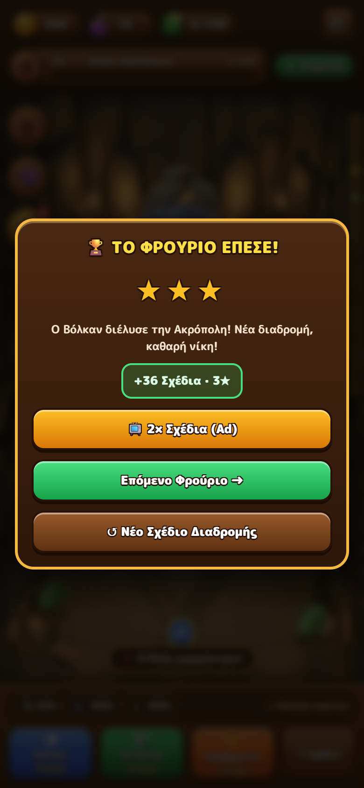

# ⚔️ Bastion Breaker: Reverse Siege

  
  &nbsp;&nbsp;&nbsp;&nbsp;
  

  <strong>Inverted Tower Defense &amp; Tactical Siege Convoy for Android</strong> 
  <em>You aren't the defender. Plot the castle flank, command the Siege Order, and shatter the Crimson Keep!</em>

  

  
  

  
  
  
  
  

---

## 📥 Direct APK Download

Always get the latest official Android APK build from this permanent link:

👉 **[Download reverse-siege.apk (Latest Release)](https://github.com/jemangr/reverse-siege-releases/releases/latest/download/reverse-siege.apk)** 👈

*(Or view all versions on the [GitHub Releases Page](https://github.com/jemangr/reverse-siege-releases/releases).)*

---

## ✨ Key Highlights (`v1.2.0 — Sculpted Realms & 50 Chapters`)

- 🏰 **Hand-Painted 3D Sculpted Realms (`390×1100`):** Seamless vertical castle corridors featuring rocky cliff walls with glowing lanterns, **23 3D PBR sprites** (3D stone tower pedestals, guardhouses, arched planked drawbridges, oak & frosted pine trees, burning bronze war-pillars), and organic **curved spline cobblestone paths**.
- 🌍 **50-Chapter Campaign across 5 Acts (150★):** Progress through **5 distinct realms** (*Ashen Borderlands, Ember Caldera, Verdant Catacombs, Frostfang Pass, Iron King's Domain*) with **5 unique castle layouts**, every 10th chapter as a Boss Citadel (`hpScale 1.00× → 4.09×`, scaled starting Gold `410g → 733g`, Lv. `1–10` Workshop Upgrades, and Act `1..5` campaign filter tabs).
- 🎯 **Clean HUD & Tactical Clarity:** English chapter names shown consistently across locales, decluttered side medallion icons without overlapping labels, subtle active-threat range rings (tap any tower to inspect), and animated curved moats disappearing beneath cliff overhangs.
- 💣 **Powder Barrels, Loot Chests & Guard Ambushes:** Detonate **Powder Barrels**, raid flanking **Iron Loot Chests**, clash with **Iron Legion Guards**, and dodge sweeping **Dragon Flame Cones**.
- 📺 **5-Placement Rewarded & Controlled Interstitial Ads (`window.ReverseAds`):** Native Android ad bridge with Demo fallback (`+100g` in Plan Phase, `2×` Victory Blueprints, Defeat Rescue Boost, scaled Workshop Supply Crate, Fortune Wheel spins, and non-intrusive Interstitial pacing).
- 🔄 **Automatic 6-Hour Update Checker & 13 `jemangr.app` Portfolio Apps.**

---

## 📸 Screenshots Gallery

| 1. Ch.1 Ashen Gatehouse, 3D Guardhouse & Spline Paths | 2. Powder Barrel Shockwave, Guards & Aegis Dome | 3. Ch.11 Lava Caldera, Smoke Veil & Meteor Barrage |
| :---: | :---: | :---: |
|  |  |  |

| 4. 50-Chapter Campaign (Act Tabs & Bosses) | 5. Siege Workshop Upgrades (Lv. 1–10) | 6. Citadel Shattered & 2× Blueprints Ad |
| :---: | :---: | :---: |
|  |  |  |

---

## 🛠️ Android Installation

1. Download **[reverse-siege.apk](https://github.com/jemangr/reverse-siege-releases/releases/latest/download/reverse-siege.apk)** on your Android device (`Android 8.0+`).
2. Open the downloaded `.apk` file.
3. If prompted, allow installation from this source once.
4. Launch **Reverse Siege** and shatter the Crimson Keep!

---

## 📄 License & Ownership

**Copyright (c) 2026 Giannis. All rights reserved.**  
Exclusive owner & developer: **Giannis** (`contact@jemangr.app` · [jemangr.app](https://jemangr.app)).
