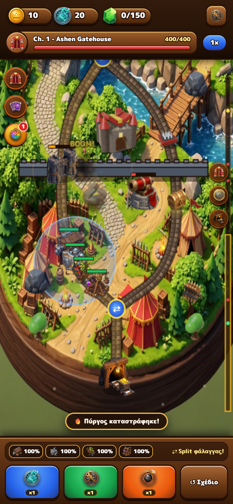
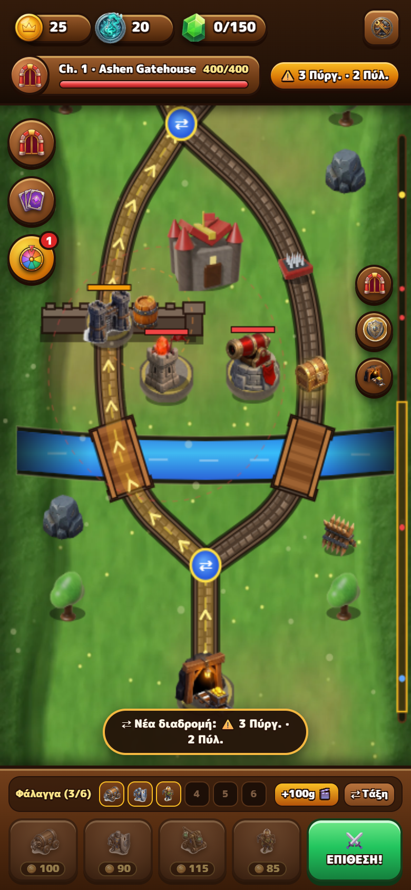

# ⚔️ Bastion Breaker: Reverse Siege

  
  &nbsp;&nbsp;&nbsp;&nbsp;
  

  <strong>Inverted Tower Defense &amp; Tactical Siege Convoy for Android</strong> 
  <em>You aren't the defender. Plot the castle flank, command the Siege Order, and shatter the Crimson Keep!</em>

  

  
  

  
  
  
  
  

---

## 📥 Direct APK Download

Always get the latest official Android APK build from this permanent link:

👉 **[Download reverse-siege.apk (Latest Release)](https://github.com/jemangr/reverse-siege-releases/releases/latest/download/reverse-siege.apk)** 👈

*(Or view all versions on the [GitHub Releases Page](https://github.com/jemangr/reverse-siege-releases/releases).)*

---

## ✨ Key Highlights (`v1.0.0`)

- ⚔️ **Inverted Tower Defense (You Are the Invader):** Instead of placing towers, you recruit a custom siege convoy and plot the winning route through enemy castle crossroads (`⇄`)!
- ⇄ **Dynamic Plan & Live Mid-Siege Re-Routing:** Compare enemy tower range rings in Planning Phase, and flip upcoming junctions live mid-battle as towers crumble.
- 🛡️ **4 Distinct Siege Units:**
  - **Battering Ram:** Heavy armor (`-55%` arrow damage) + `×3.6` Gate & Keep smash power.
  - **Shield Wall:** Projects an Aegis Dome blocking `72%` of Archer arrows & `40%` of Cannon splash for trailing units.
  - **Alchemist Trebuchet:** Lobs parabolic alchemical firebombs from long range for `×2.35` Tower damage.
  - **Sapper Engineer:** Auto-disarms **Iron Spike Traps** ahead and heals nearby allies.
- 💨 **3 Commander Powers:** Blind towers with **Smoke Veil (`5.5s`)**, heal the convoy with **Field Repair (`4.5s`)**, or drop a 3-shot **Meteor Barrage**.
- 🏰 **5-Chapter Story Campaign & Carved-Wood 3D UI:** Follow Grand Engineer Volkan across 5 Fortresses in Bastion Breaker's **Option 1 Bouncy 3D** wood HUD with Workshop Upgrades, Fortune Wheel, Greek/English localization & studio Web Audio.
- 🔄 **Automatic 6-Hour Update Checker:** Checks `version.json` silently every 6 hours + one-tap check in Settings, with **Our Other Apps** listing all 13 apps from [jemangr.app](https://jemangr.app).

---

## 📸 Screenshots Gallery

| 1. Route Planning (`⇄`) & Convoy | 2. Live Siege, Aegis Dome & Gate Smash | 3. Smoke Veil, Barrage & Mid-Siege Flank |
| :---: | :---: | :---: |
|  |  |  |

| 4. 5-Chapter Story Campaign | 5. Siege Workshop Upgrades | 6. Citadel Shattered (3★ Victory) |
| :---: | :---: | :---: |
|  |  |  |

---

## 🛠️ Android Installation

1. Download **[reverse-siege.apk](https://github.com/jemangr/reverse-siege-releases/releases/latest/download/reverse-siege.apk)** on your Android device (`Android 8.0+`).
2. Open the downloaded `.apk` file.
3. If prompted, allow installation from this source once.
4. Launch **Reverse Siege** and shatter the Crimson Keep!

---

## 📄 License & Ownership

**Copyright (c) 2026 Giannis. All rights reserved.**  
Exclusive owner & developer: **Giannis** (`contact@jemangr.app` · [jemangr.app](https://jemangr.app)).
