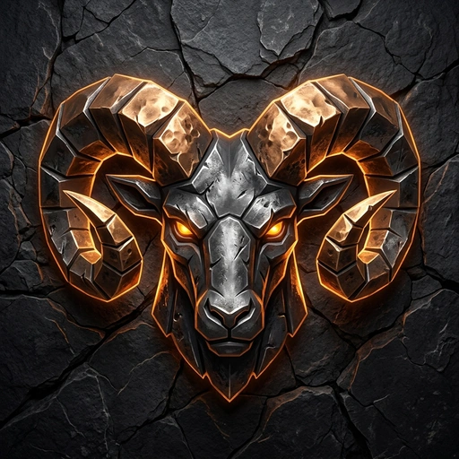
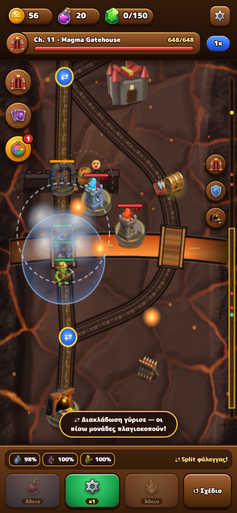
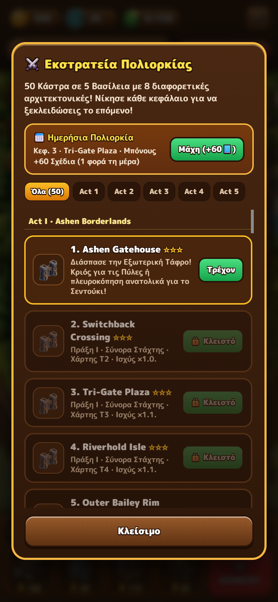
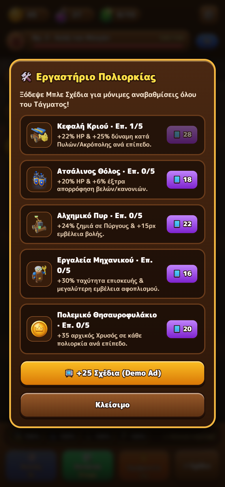

# ⚔️ Bastion Breaker: Reverse Siege

  
  &nbsp;&nbsp;&nbsp;&nbsp;
  

  <strong>Inverted Tower Defense &amp; Tactical Siege Convoy for Android</strong> 
  <em>You aren't the defender. Plot the castle flank, command the Siege Order, and shatter the Crimson Keep!</em>

  

  
  

  
  
  
  
  

---

## 📥 Direct APK Download

Always get the latest official Android APK build from this permanent link:

👉 **[Download reverse-siege.apk (Latest Release)](https://github.com/jemangr/reverse-siege-releases/releases/latest/download/reverse-siege.apk)** 👈

*(Or view all versions on the [GitHub Releases Page](https://github.com/jemangr/reverse-siege-releases/releases).)*

---

## ✨ Key Highlights (`v2.0.0 — Overhaul Edition`)

- 🏰 **5 Bespoke WebGL2 PBR 2.5D Terrains (`780×2200`) & 8 Fortress Topologies (`T1..T8`):** Seamless vertical realms across **5 biomes**, continuous **2.5D Stone Curtain Walls** with masonry bastion piers anchoring every Gate, organic midpoint-quadratic Bezier roads (`sampleSpline`), and **mathematically aligned Bridges** placed at exact `road × moatCenterY` intersections.
- 🔒 **Locked Progressive 50-Chapter Campaign + Daily Siege:** Chapters `2–50` unlock sequentially as you shatter each predecessor (every 10th chapter is a **Boss Citadel** with Keep Bombard & Royal Sorties), plus a **Daily Siege** seeded procedural fortress mode.
- 🎯 **Deep Tactical Counters & Mid-Siege Squad Split (`⇄`):** Tight starting budget (`300g–452g`), non-Ram Gate armor (`0.35×`), Flame ignoring Shield domes (`1.35×` damage), Mortar telegraphs, Frost slow aura, Acid anti-heal traps, and rear-junction flipping mid-battle (`⇄`) to split convoys onto flanking lanes.
- 💥 **Tap-to-Aim Limited Commander Powers:** Deliberate strategic casts (`×1` charge, `×2` at **Tactics Lv.5+**) for **Smoke Veil**, fixed-ratio **Field Repair**, and **Meteor Barrage** — zero infinite heal/barrage spam.
- 🔧 **6-Upgrade Siege Workshop (`Lv. 1–10`) & Smart Defeat Diagnostics:** Level **Ram**, **Shield**, **Trebuchet**, **Sapper**, **Vault**, and **Tactics**, plus contextual loss hints explaining the exact counter that broke your convoy.
- 📺 **Store-Ready Ad Bridge (`window.ReverseAds`):** Native Android, iOS WebView, CrazyGames & Poki ad bridge supporting Rewarded Ads (`+100g`, `2×` Victory Blueprints, Extra Wheel Spin, Daily Retry, Mercy Boost) with offline Demo fallback.

---

## 📸 Screenshots Gallery

| 1. Ch.1 Ashen Gatehouse, Curtain Walls & Aligned Bridges | 2. Powder Barrel Shockwave, Guards & Mid-Siege Split | 3. Ch.11 Lava Caldera, Tap-to-Aim Smoke & Charges |
| :---: | :---: | :---: |
|  |  |  |

| 4. Locked 50-Chapter Campaign & Daily Siege | 5. 6-Card Siege Workshop (Lv. 1–10) | 6. Citadel Shattered & 2× Blueprints Ad |
| :---: | :---: | :---: |
|  |  |  |

---

## 🛠️ Android Installation

1. Download **[reverse-siege.apk](https://github.com/jemangr/reverse-siege-releases/releases/latest/download/reverse-siege.apk)** on your Android device (`Android 8.0+`).
2. Open the downloaded `.apk` file.
3. If prompted, allow installation from this source once.
4. Launch **Reverse Siege** and shatter the Crimson Keep!

---

## 📄 License & Ownership

**Copyright (c) 2026 Giannis. All rights reserved.**  
Exclusive owner & developer: **Giannis** (`contact@jemangr.app` · [jemangr.app](https://jemangr.app)).
